## About Me

I am an **AI student** at the **University of Technology Sydney**, with a strong interest in Data Science and Machine Learning. Currently explore LLM and MLOps.

## Projects

### [E-commerce Customer Segmentation](https://github.com/LouisTran1701/ecommerce-customer-segmentation)

Developing a K-Means algorithm for customer segments, developing a FastAPI backend and React dashboard. Exploring SHAP for model explanations.

## GitHub Analytics

## Tech stack

| Category | Technologies |
| :--- | :--- |
| **Languages** |  ![Java](https://img.shields.io/badge/Java-ED8B00?style=for-the-badge&logo=data:image/svg%2bxml;base64,PHN2ZyB4bWxucz0iaHR0cDovL3d3dy53My5vcmcvMjAwMC9zdmciIHZpZXdCb3g9IjAgMCAyNCAyNCIgZmlsbD0id2hpdGUiPjxwYXRoIGQ9Ik05LjA0NyAxOS4zODdzLS40NTUuNDUtLjEwNy42MzNjMS40Mi43NDggMy41NTMuODE4IDUuNjE3LjE1NSAwIDAgLjcwOC0uNDE1LjI0LS42NTQtMS42MzctLjgzNC00LjUyNi0uNjQyLTUuNzUtLjEzNHptLTEuMDc3IDIuMjJzLS40ODYuNTA1LS4xMDIuN2MxLjc4Mi45MDYgNC43MDYuOTEgNy4yMTQuMTcgMCAwIC42MTYtLjQwNy4xOS0uNjYtMi4xMjgtLjktNS41OS0uNzI4LTcuMzAyLS4yMXptOC4zOTgtNC42NnMtag.ODM2LjUzMy40MDcuODkzYy0xLjY4IDEuNDA4LTYuMTkgMS40Ny04LjI5My4wNzYtLjU1NC0uMzY2LjQyNS0uODUzLjQyNS0uODUzLjk5LjIzIDMuNjUyLjQ4NCA1LjkyLS4wMjMgMS4wNTQtLjIzNiAxLjU0LS4wOTMgMS41NC0uMDkzem0tNS4wNi03LjM5Yy42NzcgMS4yMDUtLjMzMyAyLjM3LTEuNDI0IDMuNDIgMS4wMDItLjkxIDEuODMtMi4wNzIgMS40MjQtMy40MnptMi45NzMtMi42MTdjLjY5IDEuMTQtLjM3IDIuMTE1LTEuMTI3IDMuMDkzIDEuMDk2LS45OCAxLjYzMi0yLjA5NiAxLjEyNy0zLjA5M3pNMTguODk1IDE5LjUzYy0xLjM1NSAyLjE4LTUuMDQgMi44Ny04LjM5IDIuNTA4LTMuMDQ1LS4zMy00LjQ4LTEuNTU0LTQuNDgtMS41NTRzLjU0LjQzNyAxLjQ4OC43NWMzLjA4NCAxLjAyIDcuNzM3LjggMTAuNDU3LS42OTYgMCAwIC44NjMtLjQ0LjkyNS0xLjAwOHptMS4wOTctNC4xNDhjLS42OCAxLjQwNS0yLjg2NCAyLjY1Mi02LjUyNCAzLjAxOC0zLjIzNy4zMjMtNi4xMS0uMjc0LTcuODUtMS4zNSAwIDAtLjQ0OC4zMzcuMzQ4LjY1IDIuNTMyLjk5NiA2Ljg0OCAxLjI3MiAxMC4zNy0uMTcgMi4zNi0uOTY3IDMuNjU2LTIuMTQ4IDMuNjU2LTIuMTQ4eiIvPjwvc3ZnPg==&logoColor=white)    |
| **AI & Data** |          |
| **Applications** |     |
| **Databases** |    |
| **Tools** |    |

